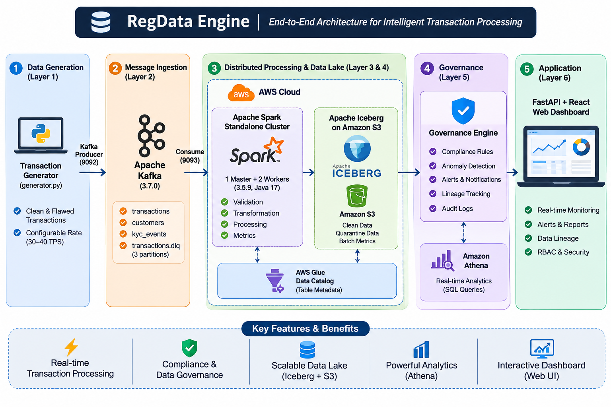
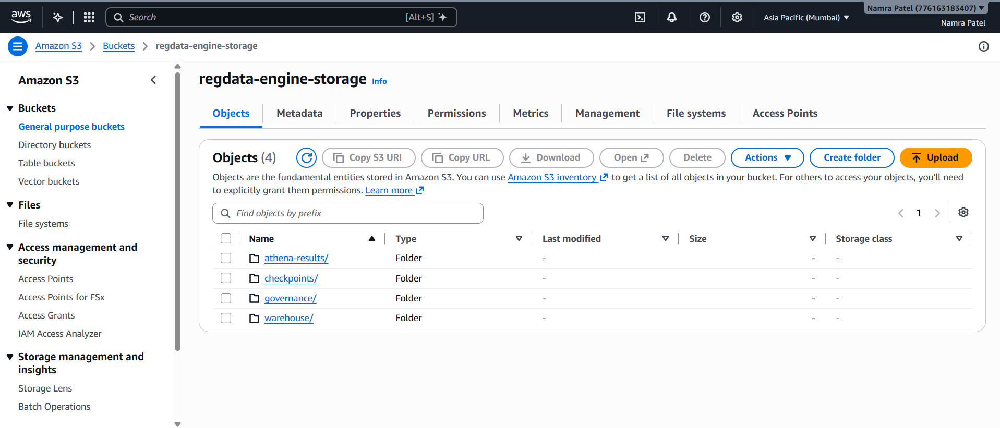
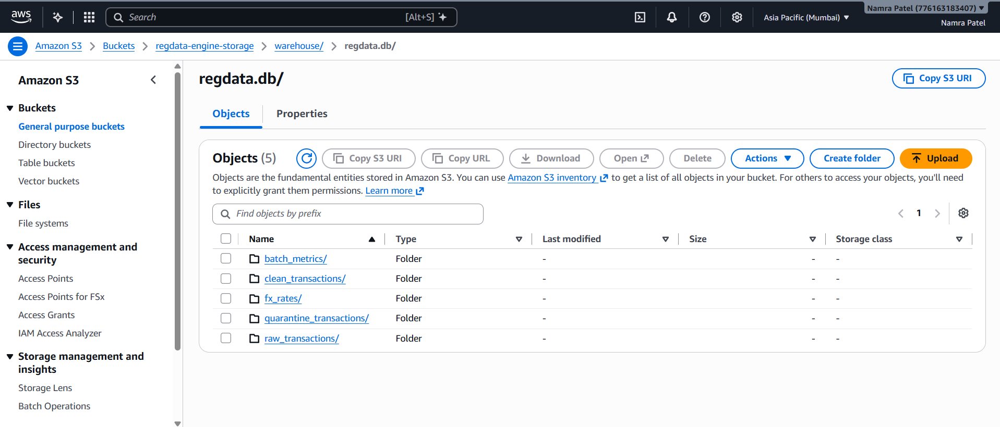
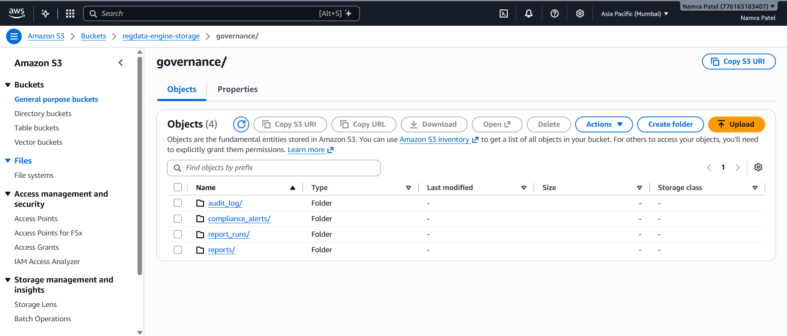
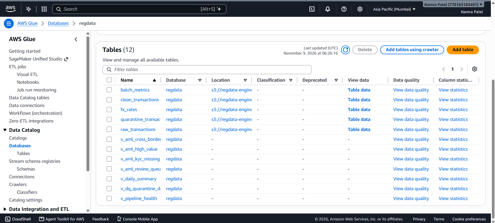
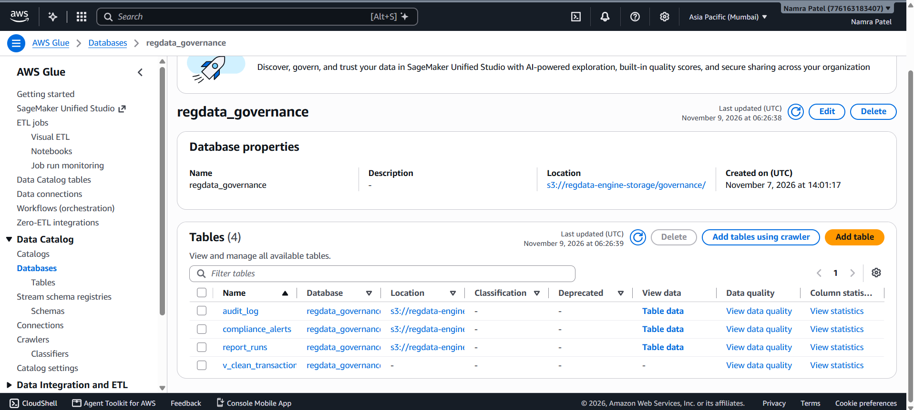
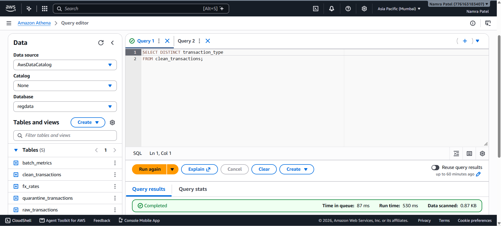
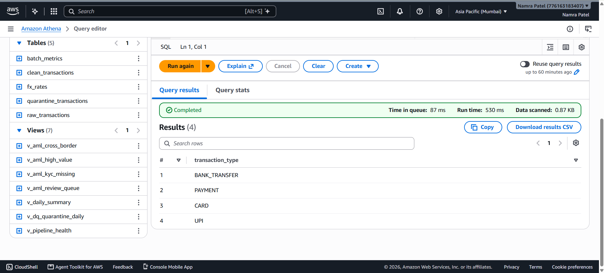
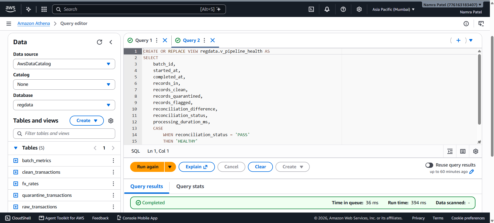
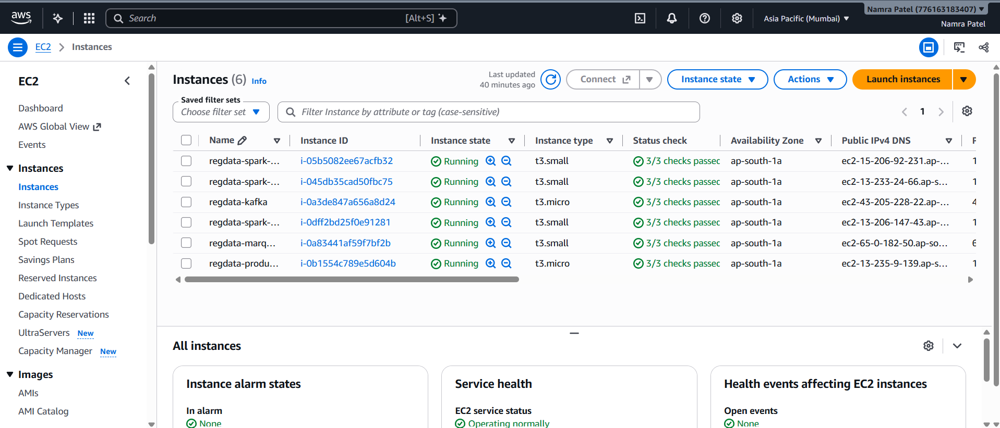

# RegData Engine

A production-grade, distributed streaming data-engineering and compliance platform built with **Apache Kafka**, **Apache Spark**, **Apache Iceberg**, **AWS Glue**, **Amazon S3**, **Amazon Athena**, **FastAPI**, and **React**.

## 📌 Project Overview

RegData Engine is an end-to-end streaming data architecture designed to ingest, validate, classify, audit, and analyze financial transaction data in real time. Developed collaboratively by our engineering team, the platform features distributed micro-batch stream processing, automated compliance rule evaluation, PII data masking, OpenLineage tracking via Marquez, and a modern web dashboard.

### Core Architecture Layers

* **Layer 1-2 (Ingestion):** Python synthetic transaction generator publishing messages to **Apache Kafka 3.7.0**.
* **Layer 3 (Processing):** Distributed **Apache Spark 3.5.9** cluster (Master/Worker) consuming streams via structured streaming.
* **Layer 4 (Storage & Analytics):** **Apache Iceberg 1.9.2** table format backed by **Amazon S3**, cataloged via **AWS Glue Data Catalog**, and queried via **Amazon Athena**.
* **Layer 5 (Governance & Lineage):** YAML-based compliance rules engine, PII masked views, audit logging, **AWS SNS** alerts, and **OpenLineage** integration with **Marquez**.
* **Layer 6 (Presentation & Operations):** **FastAPI** backend and **React** single-page application deployed via **Docker** on AWS EC2.

---

## 🏗️ System Architecture & Infrastructure

### 1. End-to-End Data Flow Architecture



### 2. Detailed Infrastructure Setup & EC2 Distribution

The system runs across multiple isolated Amazon EC2 instances within the same VPC (`ap-south-1` Mumbai region), leveraging private IP networking for secure inter-service communication and assigned IAM roles for zero-credential cloud access:

* **Kafka EC2 Instance:** Hosts Apache Kafka 3.7.0 and manages the primary `transactions` streaming topic.
* **Spark Master EC2 Instance (`t3.small`):** Runs the Spark Master service, application driver (in client deployment mode), and acts as the deployment host for containerized web applications.
* **Spark Worker EC2 Instances (`t3.small` x2):** Two dedicated worker nodes providing distributed compute resources for micro-batch execution.
* **Marquez EC2 Instance (`t3.small`):** Runs Dockerized Marquez API, PostgreSQL backend, and Web UI for OpenLineage tracking.
* **Storage & Catalog Services:** Amazon S3 (`s3://regdata-engine-storage`) holds all Parquet data and Iceberg metadata, while AWS Glue Data Catalog maintains table schemas.

---

## 🖼️ AWS Infrastructure & Console Verification

*(Note: Replace the image markdown paths below with your actual AWS console screenshots stored in your repository assets).*

### 1. Amazon S3 Storage
> *Description: S3 bucket `regdata-engine-storage` folders.*
> 
> 
> 

### 2. AWS Glue Data Catalog
> *Description: Glue database `regdata` and `regdata_governance` showing registered Iceberg table schemas.*
> 
> 

### 3. Amazon Athena SQL Queries
> *Description: Athena query editor executing analytical views and data-quality checks.*
> 
> 
> 

### 4. Spark Cluster Management & UI
> *Description: Spark Master Web UI (Port 8080) showing active worker nodes and cluster resources.*
> 

### 5. EC2 instances
> *Description: running EC2 instances.*
> 

### 6. Web UI
> *Description: Website deployed on ec2 instance.*
> 
> 

---

## 🌐 Website Deployment Architecture (Phase 6)

The presentation layer consists of a decoupled **React SPA frontend** and a **FastAPI backend** containerized via Docker and deployed on AWS EC2.

### Deployment Workflow:
1. **Containerization:** Separate Dockerfiles package the React application (served via Nginx) and the FastAPI backend.
2. **Amazon ECR Integration:** Docker images are tagged and pushed to Amazon Elastic Container Registry (ECR).
3. **Dynamic URL Configuration:** To prevent hardcoded localhost errors across cloud deployments, the React frontend dynamically resolves its API endpoint:
   ```javascript
   const API_BASE_URL = `http://${window.location.hostname}:8000/api`;
   ```
4. **EC2 Orchestration:** Production updates on the EC2 instance are pulled and deployed seamlessly using Docker Compose:
   ```bash
   docker compose pull
   docker compose up -d --force-recreate
   ```

---

## 📂 Repository Structure

```
regdata-engine/
├── config/              # Spark session and catalog configuration
├── processing/          # Core PySpark ETL, validation, parsing, and compliance logic
├── rules/               # YAML-based compliance rules (cross-border, velocity, etc.)
├── phase5/              # Governance engine, record tracing, and report generation scripts
├── sql/                 # Athena analytical views and validation queries
├── frontend/            # React SPA dashboard (Dockerized)
├── backend/             # FastAPI application (Dockerized)
├── main.py              # Spark streaming application entry point
└── README.md            # Project documentation
```

---

## 🚀 Getting Started & Prerequisites

### Prerequisites
* **Apache Spark:** 3.5.9 (with Scala 2.12 and Java 17)
* **Apache Kafka:** 3.7.0
* **Docker & Docker Compose:** For containerized microservices and Marquez
* **AWS CLI:** Configured with appropriate IAM role permissions for S3, Glue, and Athena

---

## ⚙️ Important Operational Commands

### 1. Spark Cluster Management
Start the Spark Master and Worker nodes:
```bash
# Start Spark Master
/opt/spark/sbin/start-master.sh

# Start Spark Worker (point to master private IP)
/opt/spark/sbin/start-worker.sh spark://<MASTER_PRIVATE_IP>:7077
```

### 2. Submitting the Spark Streaming Job
Run the PySpark streaming pipeline in client mode with required dependencies:
```bash
# Package application modules
zip -r regdata_app.zip config processing

# Submit to cluster
nohup spark-submit \
  --master spark://<MASTER_PRIVATE_IP>:7077 \
  --deploy-mode client \
  --driver-memory 512m \
  --executor-memory 512m \
  --py-files regdata_app.zip \
  --packages org.apache.spark:spark-sql-kafka-0-10_2.12:3.5.9,org.apache.iceberg:iceberg-spark-runtime-3.5_2.12:1.9.2,org.apache.iceberg:iceberg-aws-bundle:1.9.2 \
  main.py > spark_job.log 2>&1 &
```

### 3. Monitoring & Log Inspection
Check live streaming logs or verify running Java processes:
```bash
# Follow Spark streaming output
tail -f spark_job.log

# Verify active Spark processes (Master/Worker)
jps
```

### 4. Running the Compliance & Governance Engine
Manually trigger rule checks or trace a specific transaction ID:
```bash
# Run compliance rules evaluation
python3 phase5/engine/run_rules.py

# Trace record lineage
python3 phase5/trace/trace.py TXN-6ae02fad81a3
```

### 5. Website Docker Deployment
Rebuild and launch containerized frontend and backend services on EC2:
```bash
# Rebuild containers without cache (ensures dynamic IP binding)
docker compose build --no-cache

# Start containers in detached mode
docker compose up -d --force-recreate
```

---

## 🛡️ Security & Configuration Notes

* **RAM Optimization:** On `t3.small` instances (2GB RAM), ensure a Linux swap file (`2GB`) is active to prevent Out-Of-Memory (OOM) kernel crashes:
  ```bash
  sudo fallocate -l 2G /swapfile
  sudo chmod 600 /swapfile
  sudo mkswap /swapfile
  sudo swapon /swapfile
  echo '/swapfile none swap sw 0 0' | sudo tee -a /etc/fstab
  ```
* **Security Groups:** Restrict inbound traffic on SSH (port 22), Spark UI (port 8080), and Backend API (port 8000) to authorized IP ranges.